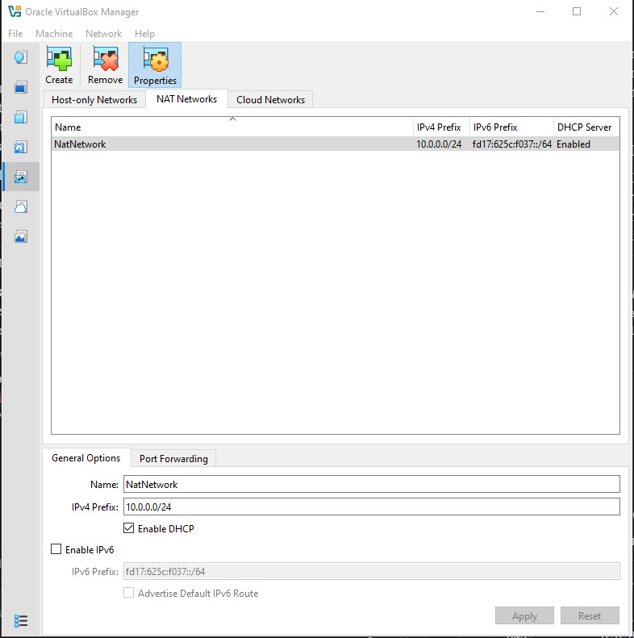
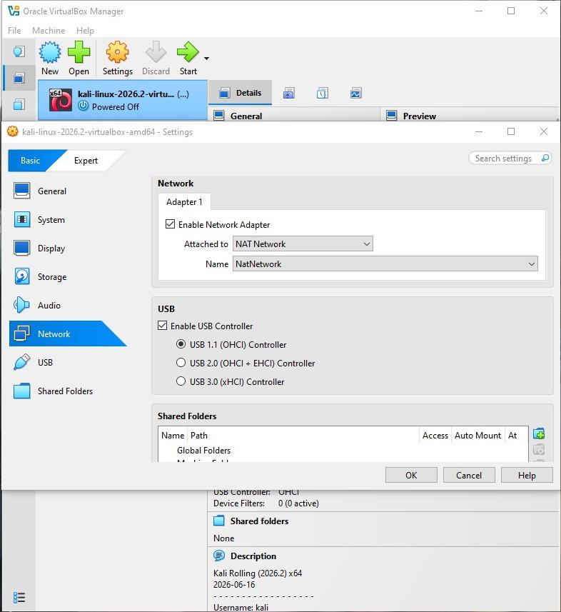
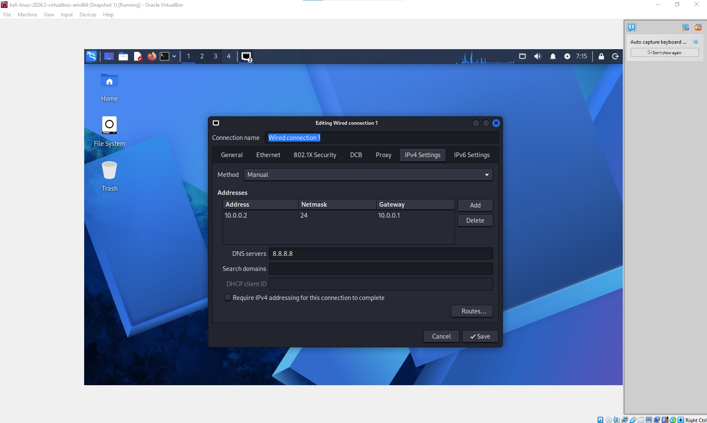
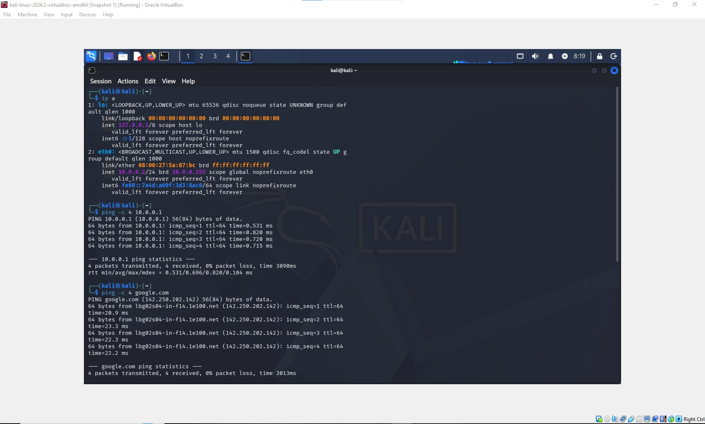

<div align="center">

# 🔐 Cybersecurity Lab Environment Setup

**Building an isolated virtual lab for penetration testing and ethical hacking practice**
</div>

<p align="center">
  
  
  
  
  
  
  
  
  
  
  
  
</p>

---

## 📌 Project Overview

This project focuses on setting up a **virtual cybersecurity and penetration-testing laboratory** using VirtualBox and Kali Linux.

The lab creates a controlled, isolated environment where cybersecurity tools, network scanning, reconnaissance, and other security-testing activities can be performed safely without putting the real host machine or home network at risk. The lab runs on a private virtual network so that additional machines (Windows, Android, Server 2016) can be added in future weeks and used as practice targets.

---

## 🎯 Objectives

- Install and configure VirtualBox.
- Create a private **NAT Network** (`10.0.0.0/24`) for the lab.
- Import and configure Kali Linux as a virtual machine.
- Assign a static IP address (`10.0.0.2/24`) to the Kali VM.
- Verify network connectivity and DNS resolution.
- Take a clean VM snapshot for recovery.
- Document the complete setup process, including problems and fixes.

---

## ⚙️ Lab Configuration

| 🧩 Component       | ⚙️ Configuration   |
| ------------------ | ------------------ |
| 🖥️ Host OS         | Windows 10 / 11    |
| 🧰 Hypervisor      | VirtualBox         |
| 🐉 Security OS     | Kali Linux 2026.2  |
| 🧠 Kali RAM        | 2048 MB            |
| 🌐 Virtual Network | NAT Network        |
| 📡 Network Address | `10.0.0.0/24`      |
| 🐧 Kali IP Address | `10.0.0.2/24`      |
| 🚪 Default Gateway | `10.0.0.1`         |
| 🌍 DNS Server      | `8.8.8.8`          |
| 🔮 Future VM Range | `10.0.0.3 – 10.0.0.99` |

---

# 🪜 Lab Setup Procedure

## Step 1. Install 7-Zip
Installed 7-Zip to extract the Kali Linux virtual machine package, distributed as a `.7z` archive.

## Step 2. Install VirtualBox
Downloaded and installed VirtualBox as the hypervisor. 

*Note: The VirtualBox base installer and the Extension Pack are separate downloads — the Extension Pack alone cannot be installed without the main VirtualBox program already present.*

## Step 3. Create the NAT Network
Created a dedicated NAT Network in VirtualBox (**File → Tools → Network → NAT Networks**):

```text
Network Name: NatNetwork
IPv4 Prefix:  10.0.0.0/24
DHCP:         Enabled
```



A NAT Network (rather than plain NAT) was used because it allows multiple VMs attached to the same network to communicate with each other while still having outbound internet access — necessary for future multi-VM pentesting exercises.

## Step 4. Import Kali Linux
Downloaded the official Kali Linux VirtualBox image from kali.org/get-kali and imported it into VirtualBox using **File → Open** (imported directly as an existing VM rather than through the Import Appliance wizard, since the download was already in VirtualBox's native format).

```text
Adapter 1
Attached to:  NAT Network
Network:      NatNetwork
Adapter Type: Intel PRO/1000 MT Desktop
RAM:          2048 MB
```



## Step 5. Configure the Kali Linux Network
Set a manual static IP on Kali via **Wired Connection 1** → **IPv4 Settings**:

```text
IP Address:   10.0.0.2
Subnet Mask:  24
Gateway:      10.0.0.1
DNS:          8.8.8.8
```

Applied the change using:

```bash
sudo nmcli connection down "Wired connection 1"
sudo nmcli connection up "Wired connection 1"
```



## Step 6. Create a Clean VM Snapshot
After verifying the setup worked, took a VirtualBox snapshot to preserve this known-good baseline:

```text
Snapshot name: Clean setup - network configured
```
This baseline can be restored if a future exercise breaks the configuration.

---

# 🔎 Lab Verification

| ✅ Test            | 🧾 Command        | 🎯 Result
| ------------------ | ------------------ | ------------------ |
| 🌐 Check IP address | `ip a`              | `10.0.0.2/24` confirmed on eth0
| 📡 Test gateway    | `ping -c 4 10.0.0.1` | 4/4 replies, 0% packet loss
| 🌍 Test DNS + internet | `ping -c 4 google.com`  | 4/4 replies, 0% packet loss



---

# 🐞 Problems Encountered & Solutions
Documenting problems and their fixes is a crucial part of the learning process.

## Problem 1. Extension Pack Downloaded Instead of Main Installer
Initially downloaded only the VirtualBox Extension Pack from the downloads page, mistaking the "**Accept and download**" button for the actual VirtualBox installer.

Fix: The main installer is a separate link under "**VirtualBox Platform Packages**" → **Windows hosts**. The Extension Pack is only installed after VirtualBox itself.

## Problem 2. Network Disconnect Popup While Editing IPv4 Settings
On Kali 2026.2, switching to manual IP configuration triggered a repeating "network connection disconnected" popup.

**Fix:**
```bash
sudo nmcli connection modify "Wired connection 1" ipv4.dad-timeout 0
```

## Problem 3. Static IP Not Applying (Still Showing DHCP)
After saving the manual IPv4 settings, `ip a` still showed a dynamically assigned address instead of the static one.

**Fix:** The connection needed to be manually cycled to pick up the new settings:

```bash
sudo nmcli connection down "Wired connection 1"
sudo nmcli connection up "Wired connection 1"
```

## Problem 4. Gateway Unreachable After Snapshot Restore
After restoring the Kali VM from a snapshot, `ping 10.0.0.1` returned "Destination Host Unreachable" even though the network adapter settings looked correct.

**Fix:** Disconnected and reconnected the virtual network cable from within the running VM **(Devices → Network → Disconnect/Connect Network Cable)**, which refreshed the adapter and restored connectivity.

---

# 💡 What I Learned
- **NAT vs. NAT Network:** A NAT Network lets multiple VMs on the same virtual network talk to each other while still reaching the internet, which regular NAT does not support. This is essential for a multi-machine lab.

- **Static IP configuration on Linux:** How to set and verify manual IPv4 addressing using the GUI and `nmcli`, and how connection changes sometimes need to be manually re-applied to take effect.

- **Snapshots as safety nets:** Taking a snapshot at a known-working state makes it possible to recover quickly if later configuration changes (or VM corruption) break the setup.

- **Troubleshooting methodically:** Working through connectivity issues layer by layer (adapter settings → NAT Network config → cable connection → DNS) rather than guessing.

- **Documentation matters:** Recording exact commands, settings, and the problems hit along the way makes the project a highly useful reference.

---

# 🔐 Security & Ethical Use
This lab is intended strictly for educational purposes on machines and networks I own. It is not to be used against systems without explicit authorization.

---

# 🔗 Tools & Resources
- **7-Zip:** https://7-zip.org/download.html
- **VirtualBox:** https://virtualbox.org/wiki/Downloads
- **Kali Linux:** https://kali.org/get-kali

---

# 👤 Author
**Omer Bawazir**
Cybersecurity Graduate — Batch B084
NetworkWalks Academy

**LinkedIn:** https://www.linkedin.com/in/OmerSecure

---

# 📌 Project Information

**Program:** Cybersecurity Program
**Week:** 01
**Project:** Cybersecurity & Pentesting Lab Setup
**Organization:** NetworkWalks Academy

---
